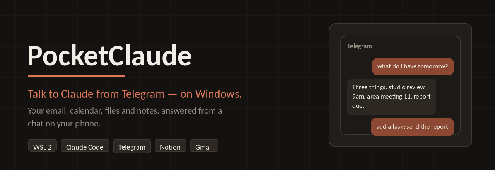
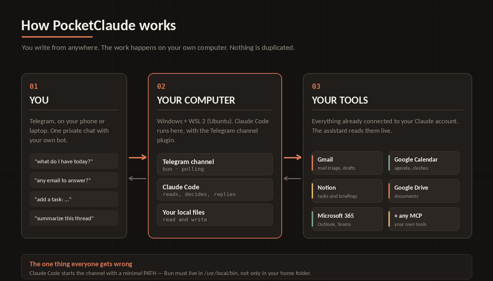
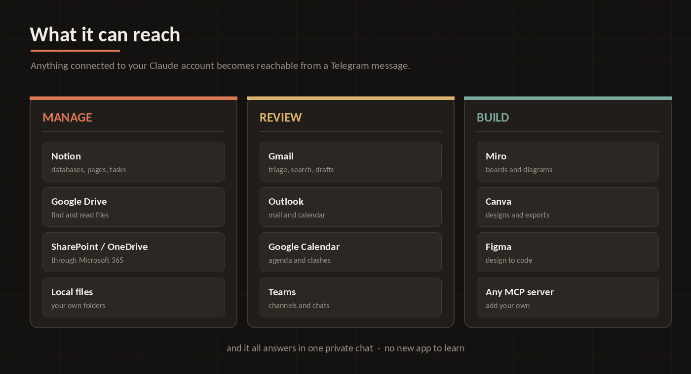
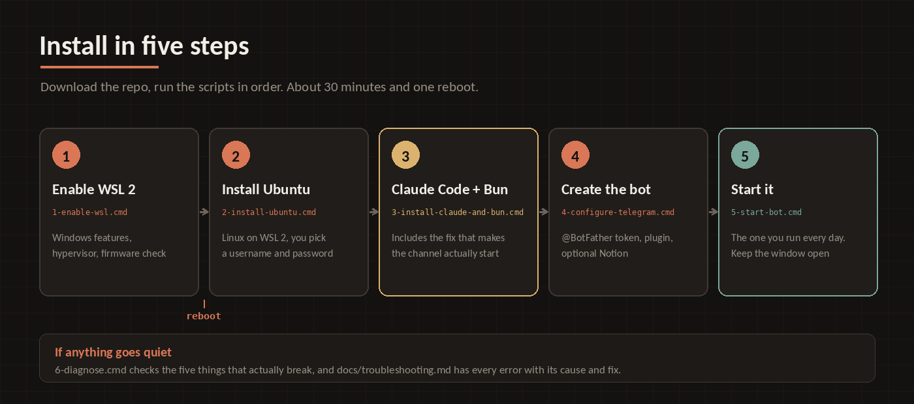

# PocketClaude



**Habla con Claude desde Telegram, en Windows.** Instalación completa y probada
del canal de Telegram de Claude Code en una PC con Windows a través de WSL 2, más
una capa opcional de asistente personal que lee tu correo y tu agenda y mantiene
tus tareas en Notion.

English: [README.md](README.md)

---

## Por qué existe esto

Anthropic publica un plugin oficial de Telegram para Claude Code. En macOS y Linux
funciona de una. **En Windows no**, y las razones no están en la documentación:

1. En **Windows nativo**, el plugin envía mensajes pero nunca los recibe. El bot
   parece muerto. Es un error conocido y sin resolver
   ([claude-code#39776](https://github.com/anthropics/claude-code/issues/39776),
   [claude-plugins-official#797](https://github.com/anthropics/claude-plugins-official/issues/797)).
   La solución es correr todo dentro de WSL 2.
2. Dentro de **WSL 2**, el plugin sigue fallando con
   `Connection failed (ENOENT): Executable not found in $PATH: "bun"`, incluso
   cuando `bun --version` responde perfectamente en tu terminal. Claude Code lanza
   los servidores MCP con un entorno mínimo, así que un Bun instalado en tu
   carpeta personal le resulta invisible. **Un enlace simbólico lo arregla**, y esa
   es la línea más importante de todo este repositorio:

   ```bash
   sudo ln -sf $HOME/.bun/bin/bun /usr/local/bin/bun
   ```

Ir desde "no tengo nada instalado" hasta "el bot me responde" tomó una tarde
completa de callejones sin salida. Este repositorio es esa tarde, comprimida en
seis scripts y una bitácora de errores, para que a ti te tome unos treinta
minutos.

> Proyecto comunitario. Sin afiliación ni respaldo de Anthropic ni de Telegram.

---

## Cómo funciona



Tú escribes desde donde estés. El trabajo ocurre en tu propia computadora, contra
tus propias cuentas. Nada se copia a un servicio ajeno y nada se duplica: tu
calendario sigue siendo tu calendario, tu bandeja sigue siendo tu bandeja.

---

## Con qué terminas

- Un **bot de Telegram que en realidad es Claude**, corriendo en tu propia
  computadora y con acceso a tus propios archivos.
- Todo lo que tengas conectado a tu cuenta de Claude — Gmail, Google Calendar,
  Google Drive, Notion, Microsoft 365 — al alcance de un chat desde el celular.
  *"¿Qué reuniones tengo mañana?"*, *"agrega tarea: enviar el informe el viernes"*,
  *"resume el correo del decano"*.
- Opcionalmente, una **estructura de asistente personal en Notion** que organiza
  todo por frente de trabajo, convierte en tareas los correos que requieren
  acción, y te escribe un resumen diario. Ver
  [docs/notion-assistant.es.md](docs/notion-assistant.es.md).



---

## Requisitos

| Qué | Notas |
|---|---|
| Windows 10 (compilación 1809 o superior) o Windows 11 | La edición Home sirve |
| Un procesador con virtualización, **activada en el BIOS** | El paso 1 lo verifica por ti |
| Un plan de pago de Claude (Pro, Max, Team o Enterprise) | Claude Code va incluido; el plan gratuito no lo incluye |
| Una cuenta de Telegram | El bot en sí es gratis |
| Unos 30 minutos y un reinicio | |

Todo lo que se instala aquí es gratuito: WSL 2, Ubuntu, Claude Code (incluido en
tu plan), Bun y el bot de Telegram.

---

## Instalación



Descarga este repositorio (botón verde **Code** → **Download ZIP**), descomprímelo
donde quieras y ejecuta los scripts de la carpeta `scripts/` en orden. Cada uno te
dice qué hizo y cuál sigue.

### Paso 1 — Habilitar WSL 2

Doble clic en **`1-enable-wsl.cmd`** y acepta el aviso de administrador.

Activa las dos características de Windows que WSL necesita, configura el
hipervisor para que arranque con el sistema, actualiza WSL desde internet y lee el
estado de tu firmware. Deja todo en `wsl-report.txt`.

Al final te dice una de dos cosas:

- **"Fixes applied. REBOOT now"** → reinicia y pasa al paso 2.
- **"virtualization is DISABLED in your BIOS"** → esto es lo único que ningún
  script puede hacer por ti. Reinicia, pulsa la tecla de configuración de tu
  fabricante mientras enciende (HP `F10`, Dell `F2`, Lenovo `F1`/`F2`, ASUS/Acer
  `F2` o `Supr`), busca **Virtualization Technology** / **Intel VT-x** /
  **SVM Mode**, ponla en **Enabled**, guarda con `F10` y deja que arranque
  Windows.

### Paso 2 — Instalar Ubuntu

Doble clic en **`2-install-ubuntu.cmd`**.

Ubuntu se descarga y abre una ventana pidiendo un usuario y contraseña de Linux.
Usa minúsculas, sin espacios, y **anota la contraseña**: la necesitas una vez, en
el paso 3. Luego el script muestra tus distribuciones; quieres ver `Ubuntu` con
`VERSION 2`.

### Paso 3 — Instalar Claude Code y Bun

Doble clic en **`3-install-claude-and-bun.cmd`**. Este es el paso que contiene el
arreglo de verdad.

Cambia las fuentes de paquetes de Ubuntu a HTTPS (muchas redes corporativas y
universitarias devuelven `403 Forbidden` en HTTP plano, lo que rompe `apt`),
instala Claude Code, instala Bun — con respaldo de descarga directa desde GitHub
y, si eso falla, la versión `baseline` para procesadores antiguos — y por último
enlaza Bun en `/usr/local/bin`, que es lo que permite a Claude Code encontrarlo.

Ubuntu te pide una vez la contraseña de Linux que acabas de crear.

El script termina probando Bun **en un entorno vacío**, que es como lo verá Claude
Code:

```
bun with an empty environment: /usr/local/bin/bun
1.4.2
```

Si obtienes una ruta y un número de versión, lo difícil ya pasó.

### Paso 4 — Crear el bot y conectarlo

Antes de ejecutarlo, crea tu bot: abre Telegram, busca **@BotFather**, envía
`/newbot`, ponle un nombre visible y un usuario terminado en `bot`, y copia el
token que te devuelve (`123456789:AAH...`). **Ese token es la contraseña de tu
bot: nunca lo subas a ningún repositorio ni lo compartas.**

Luego doble clic en **`4-configure-telegram.cmd`**, que hace lo siguiente:

1. Abre Claude Code para que inicies sesión (se completa en el navegador).
   Escribe `/exit` cuando veas el prompt.
2. Instala el plugin del canal de Telegram.
3. Te pide el token, lo guarda en `~/.claude/channels/telegram/.env` con permisos
   `600`, y lo verifica contra Telegram. Debes ver `"ok":true` y el nombre de tu
   bot.
4. Opcionalmente agrega el servidor MCP de Notion.

### Paso 5 — Encender el bot

Doble clic en **`5-start-bot.cmd`**. Dos cosas deciden si funciona:

- Si Claude pregunta **"Is this a project you created or one you trust?"**, **no**
  pulses Enter de una vez. La opción marcada es **"No, exit"** y cierra Claude, lo
  que se lleva el canal por delante sin avisar. Pulsa la **flecha abajo** para
  elegir "Yes, I trust this folder" y ahí sí Enter. Solo pregunta una vez.
- **Deja esa ventana abierta.** El bot vive dentro de ella.

Ahora escríbele a tu bot desde Telegram. La primera vez te responde con un código
de emparejamiento de seis caracteres. En la ventana de Claude escribe:

```
/telegram:access pair <ese código>
/telegram:access policy allowlist
```

El primer comando te autoriza; el segundo cierra el bot para que solo tú puedas
usarlo. De ahí en adelante, simplemente escríbele.

Si conectaste Notion, escribe `/mcp` una vez y autorízalo en el navegador.

---

## Uso diario

¿Lo quieres activo 24/7 sin tener tu PC encendida? Instálalo, sin costo, en un
equipo que nunca se apague: [docs/always-on.es.md](docs/always-on.es.md).

Ejecuta `5-start-bot.cmd`, acepta la confianza de la carpeta si te lo pregunta,
deja la ventana abierta y habla con tu bot desde donde estés. `/exit` lo apaga.

El bot es Claude con tus herramientas, así que los mensajes útiles se ven así:

- *"¿Qué tengo en la agenda hoy?"*
- *"¿Hay algún correo que deba responder hoy?"*
- *"Agrega tarea: entregar el informe de notas el viernes"*
- *"Resume el último mensaje de <persona>"*

---

## Usarlo desde otra computadora

Puedes instalar PocketClaude en una segunda PC con Windows (o mudarlo a una
nueva) siguiendo los mismos pasos 1 a 5. Tres cosas cambian:

- **Reutiliza el mismo bot.** En el paso 4 pega el token del bot que ya tienes;
  no hace falta crear otro con @BotFather. Si no lo tienes a mano, en @BotFather
  envía `/mybots`, elige tu bot y pulsa **API Token**.
- **Enciende el bot en una sola computadora a la vez.** Telegram entrega los
  mensajes a un solo programa por token. Si `5-start-bot.cmd` corre en dos PCs al
  mismo tiempo, se pelean por los mensajes (`409 Conflict`) y el bot responde a
  medias. Escribe `/exit` en la otra PC antes de encender esta. Si quieres las dos
  encendidas a la vez, crea un segundo bot.
- **Empareja de nuevo.** La lista de quién puede hablar con el bot vive en cada
  computadora. La primera vez que le escribas desde esta PC te dará un código:
  repite `/telegram:access pair <código>` y `/telegram:access policy allowlist`.
  Si conectaste Notion u otras herramientas, autorízalas otra vez con `/mcp`.

---

## Cuando algo falla

Ejecuta **`6-diagnose.cmd`** en una segunda ventana, con la ventana del bot
abierta. Revisa las cinco cosas que de verdad salen mal y te explica cómo leer el
resultado.

La bitácora completa de cada fallo encontrado al construir esto — con el texto
exacto del error, su causa y su solución — está en
**[docs/troubleshooting.es.md](docs/troubleshooting.es.md)**. Si llegaste aquí
desde un buscador, esa es probablemente la página que necesitas.

---

## Notas de seguridad

- Tu token vive únicamente en `~/.claude/channels/telegram/.env` dentro de WSL,
  con permisos `600`. Nunca se guarda en este repositorio. El `.gitignore` bloquea
  los archivos `.env` y `access.json` para que no puedas subirlos por accidente.
- Ejecuta siempre `/telegram:access policy allowlist` después de emparejar. Sin
  eso, la política queda en `pairing` y cualquiera que descubra el usuario de tu
  bot puede pedir un código.
- El bot es Claude Code corriendo en tu máquina, con acceso a tus archivos y a tus
  cuentas conectadas. Trata el chat de Telegram como tratarías una terminal
  abierta: no agregues a la lista blanca a gente en la que no confíes.
- Si alguna vez se filtra el token, abre @BotFather, usa `/revoke` y repite el
  paso 4 con el token nuevo.

---

## Estructura del repositorio

```
scripts/
  1-enable-wsl.cmd            Características de Windows, hipervisor, firmware
  2-install-ubuntu.cmd        Ubuntu sobre WSL 2
  3-install-claude-and-bun.cmd  Claude Code, Bun y el arreglo de /usr/local/bin
  4-configure-telegram.cmd    Inicio de sesión, plugin, token, Notion opcional
  5-start-bot.cmd             Encender el bot (este es el de todos los días)
  6-diagnose.cmd              Diagnóstico cuando el bot se queda callado
  publish-to-github.cmd       Publicar tu propia copia (opcional)
server/
  install.sh                  Bot 24/7 en un equipo Linux siempre encendido
docs/
  troubleshooting.es.md       Cada error, su causa y su solución
  notion-assistant.es.md      La capa de asistente en Notion
  always-on.es.md             Bot siempre encendido, sin tu computadora
  img/                        Diagramas usados en este README
```

---

## Créditos

Construido y documentado por [Jorge Ludena](https://github.com/) mientras armaba
un asistente personal para su trabajo académico en tres universidades. Se agradecen
aportes y correcciones: si te topas con un error que no esté en la bitácora, abre
un issue con el mensaje exacto.
